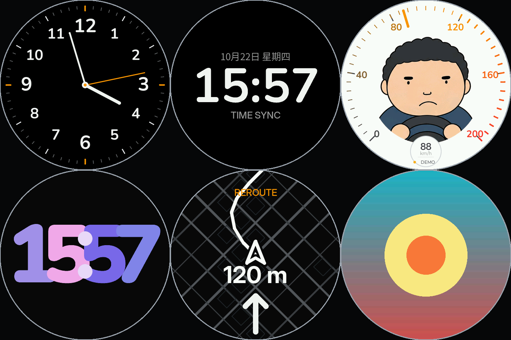
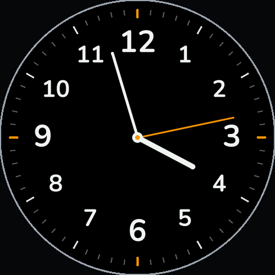
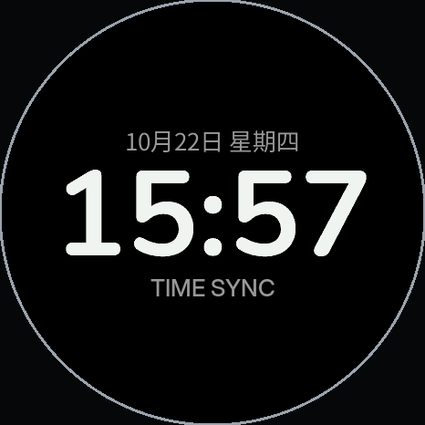
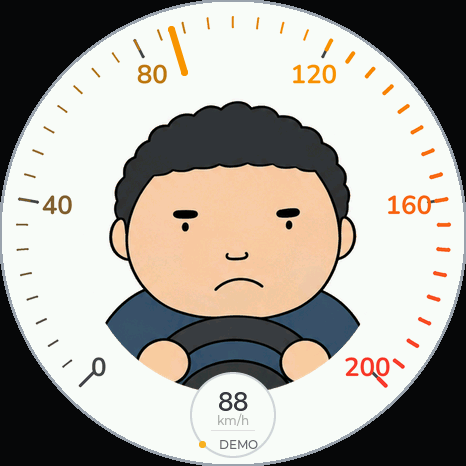
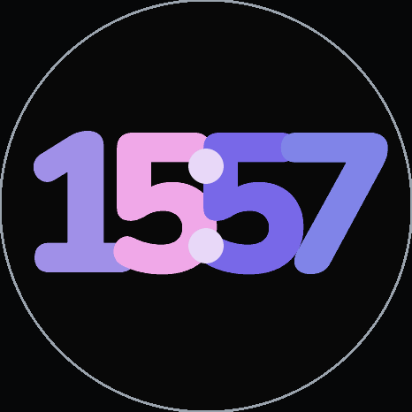
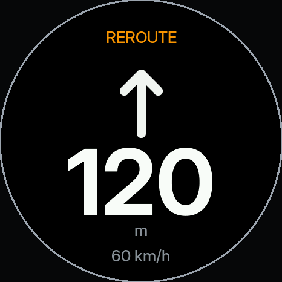
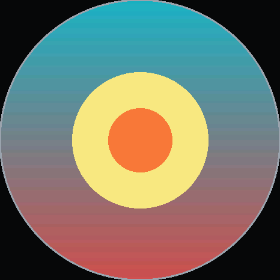
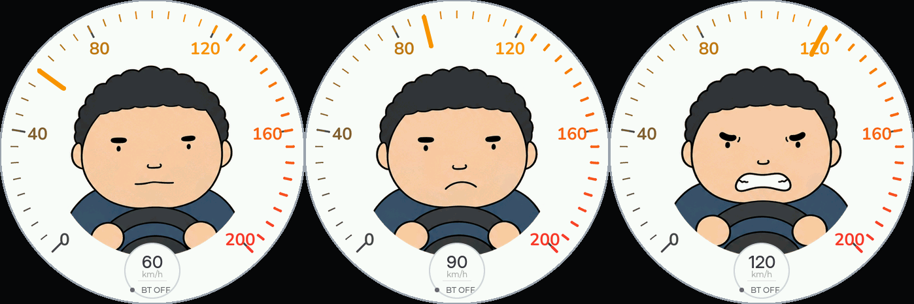
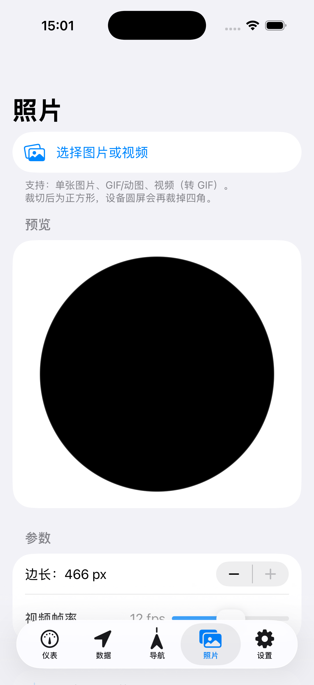
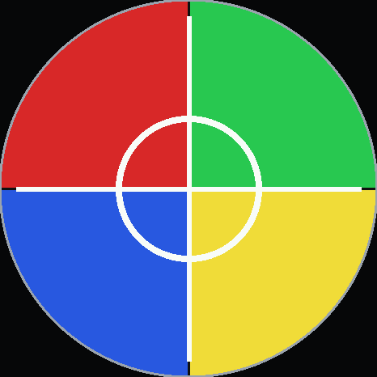

# ESP32-S3 车载仪表

一块 **466×466 圆形 AMOLED** 上的车载仪表盘：6 个表盘、BLE 实时数据、导航投屏、照片/动图表盘。
位置**不来自 GNSS** —— 全部由 iPhone 的 Core Location 通过 BLE 传入。

> ## ⚠️ 使用范围声明
>
> **本项目仅用于个人开发、学习与技术验证：不装车、不商业化、不分发。**
>
> 项目使用高德开放平台 Web 服务，其**服务协议 §3.4 明确禁止用于车载场景**。
> 请勿将本项目用于任何实际驾驶环境。



---

## 它能做什么

### 6 个表盘（可自由启用/隐藏、滑动切换）

| 表盘 | 说明 |
|------|------|
| **模拟指针钟** | 极简刻度环 + 三针 + 橙色秒针 |
| **数字钟** | 大字号时间 + 日期 + `TIME SYNC` 校时状态 |
| **速度表** | 指针 + 中央**驾驶员插画三态表情**（按车速切换）|
| **彩色数字钟** | 渐变配色 |
| **导航** | 转向箭头 + 剩余距离 + 限速 + `REROUTE` 状态 |
| **照片表盘** | 静态图 / 动图轮播，带完整烧屏防护 |

|  |  |  |
|---|---|---|
| **模拟指针钟** | **数字钟** | **速度表** |

|  |  |  |
|---|---|---|
| **彩色数字钟** | **导航** | **照片表盘** |

#### 速度表的三态表情

按车速切换中央驾驶员的表情，阈值对齐现实限速：

| 车速 | 表情 | 对应现实 |
|------|------|---------|
| `0 ~ 80 km/h` | 平静 | 常规城市 / 快速路以内 |
| `80 ~ 110 km/h` | 皱眉 | 超过快速路限速 |
| `> 110 km/h` | 咬牙 | 明显超速 |



#### 照片表盘

支持**静态图**与**动图**混排轮播，并带完整烧屏防护（亮度封顶 / 像素位移 / 自动息屏，三者独立开关）。

| iOS 侧（选图 → 裁切 → 转格式）| 设备侧 |
|---|---|
|  |  |

- **导入**：素材放 SD 卡，用 `tools/import_photos.sh` 批量转成 `.pgi`
  —— 支持 JPG / PNG / GIF / **HEIC** / **MOV / MP4**，自动抽帧、自动按设备上限压缩、自动处理 **EXIF 方向**
- **切图与轮播设置**：走 **BLE**（不需要 Wi-Fi）
- **实测帧率**：满屏 466×466 动图 **3~4 fps** —— 瓶颈是 SD 卡读速（104 ms/帧，1-bit SDMMC 的物理上限），属硬件限制

### iOS App

5 个 Tab：**仪表 / 数据 / 导航 / 照片 / 设置**

| Tab | 内容 |
|-----|------|
| **仪表** | 表盘切换（列表**由设备 BLE 上报**，新增表盘 App 无需改动）、演示速度滑块、亮度时段曲线 |
| **数据** | 实时车速 / 海拔 / 航向 / 行程统计 |
| **导航** | 目的地搜索 → 路线选择 → 下发到设备 |
| **照片** | 选图/视频 → 圆屏预览裁切（捏合缩放 / 拖动 / 旋转）→ 转 GIF 存相册；上下张切设备上的照片 |
| **设置** | 连接管理、屏幕方向、亮度、休眠 |

---

## 它是怎么工作的

```
┌─────────────────┐   BLE (CoreBluetooth)   ┌──────────────────────────────┐
│   iPhone App    │ ──────────────────────► │  ESP32-S3-Touch-AMOLED-1.75  │
│  (SwiftUI)      │   遥测 / 表盘 / 导航    │                              │
│                 │ ◄────────────────────── │  · 466×466 圆形 AMOLED       │
│  Core Location  │   状态 / 表盘列表       │  · LVGL 8.4（16bpp）         │
│  地图 / 导航    │                         │  · 8MB PSRAM / 16MB Flash    │
└────────┬────────┘                         │  · SD 卡（照片素材）         │
         │ HTTPS                            └──────────────────────────────┘
         ▼
┌─────────────────┐   HTTPS     ┌───────────────────┐
│  自建网关        │ ──────────► │  高德开放平台     │
│  (Node.js)      │             │  路线 / 路况       │
└─────────────────┘             └───────────────────┘
```

**为什么要有网关**：高德 Web 服务的 key 放在 App 里会被扒出来，所以留在服务端；
网关同时做**路线缓存**与**配额保护**（`/routes` 用 3 种策略、`/mapwindow` 不消耗高德配额）。

**为什么位置不来自 GNSS**：板子没有 GPS 模块。手机定位更准、更省电，而且手机本来就在跑导航 ——
把结果通过 BLE 发过来即可。

---

## 快速开始

### 硬件

- Waveshare **ESP32-S3-Touch-AMOLED-1.75**（CO5300 / QSPI、CST9217 触摸、PCF85063 RTC、QMI8658 IMU）
- microSD 卡（照片表盘用，可选）

### 编译与烧录

```bash
# ① UI 代码在 simulator/ui 下开发，编译前必须同步进固件目录
tools/sync_firmware.sh

# ② 编译（--build-path 固定一个路径，下一步烧录要用同一个）
BUILD=/tmp/cardash-build
arduino-cli compile \
  --fqbn "esp32:esp32:esp32s3:FlashSize=16M,PartitionScheme=app3M_fat9M_16MB,USBMode=hwcdc,CDCOnBoot=cdc,PSRAM=opi" \
  --build-property "compiler.cpp.extra_flags=-DESP32QSPI_MAX_PIXELS_AT_ONCE=4096" \
  --libraries reference/ESP32-S3-Touch-AMOLED-1.75/examples/arduino/libraries \
  --build-path "$BUILD" \
  firmware/dashboard

# ③ 烧录（端口按你的实际情况改）
arduino-cli upload -p /dev/cu.usbmodem101 \
  --fqbn "esp32:esp32:esp32s3:FlashSize=16M,PartitionScheme=app3M_fat9M_16MB,USBMode=hwcdc,CDCOnBoot=cdc,PSRAM=opi" \
  --build-path "$BUILD" \
  firmware/dashboard
```

> `--build-path` 两步必须一致；`compiler.cpp.extra_flags` 里的
> `ESP32QSPI_MAX_PIXELS_AT_ONCE=4096` 是针对这块屏的 QSPI 批量传输上限，**不能省**。

### 在电脑上跑模拟器（不需要硬件）

```bash
cd simulator && make && ./dashboard_sim
```

支持截图与脚本化验证：

```bash
./dashboard_sim --page 2 --speed 88 --status 4 --offscreen --ms 500 --shot out.bmp
```

常用参数：`--page N` 选表盘、`--speed` 车速、`--status` 链路状态、`--nav-*` 导航数据、
`--demo-speed` 演示车速、`--photo-demo <file.pgi>` 照片、`--offscreen` 无窗口、`--shot` 截图。

### 跑测试

```bash
make -C tests run       # C 单测：遥测 / 控制 / 表盘上报 / 导航 / 图片解码 / .pgi …
                        # 注意：make 的默认目标只**编译**，跑测试要用 run
cd gateway && npm install && npm test   # 网关单测（有 2 个运行时依赖）
```

> Swift 侧的单测也在 `tests/` 下（由 `tests/Makefile` 驱动），没有单独的脚本入口。
>
> **当前状态（2026-10-22 实测）**：C 单测 **845** 项（12 套）、Swift **599** 项、
> 网关 **98** 项，合计 **1542** 项**全部通过**；另有 UI 像素回归 **33** 项通过。

---

## 仓库结构

```
firmware/dashboard/     固件主程序（Arduino sketch，由 simulator/ui 同步而来）
simulator/              桌面模拟器 + 全部 UI 代码（开发主战场，可在电脑上跑单测）
  ui/                   表盘、控件、控制协议、图片解码、.pgi 格式
                        （对硬件——显示 / BLE / SD——的替身也在 ui/ 里）
ios/CarDashboardPhone/  iOS App（SwiftUI + CoreBluetooth）
gateway/                自建网关（Node.js，转发高德并做缓存 / 限流）
                        运行时依赖 2 个：@mapbox/vector-tile、pbf（/mapwindow 用）
tools/                  .pgi 转换、素材批量导入、固件同步、串口日志等脚本
tests/                  C / Swift / Node 单测与测试数据
docs/                   设计文档、协议、部署、排障（见下）
reference/              厂商资料（原理图、示例、库；gitignore）
```

---

## 文档

| 文档 | 内容 |
|------|------|
| [docs/architecture.md](docs/architecture.md) | 整体架构与模块划分 |
| [docs/hardware.md](docs/hardware.md) | 硬件规格与引脚 |
| [docs/ble.md](docs/ble.md) | **BLE 协议**：遥测包、控制命令、表盘上报（含紧凑格式）|
| [docs/photo-gif-design.md](docs/photo-gif-design.md) | 照片/动图表盘设计与 `.pgi` 格式 |
| [docs/nav-backend.md](docs/nav-backend.md) | 导航后端（网关）接口与部署 |
| [docs/nav-app-ux.md](docs/nav-app-ux.md) | 导航交互设计 |
| [docs/deployment.md](docs/deployment.md) | 烧录与部署流程 |
| [docs/development-guide.md](docs/development-guide.md) | 开发约定（新增表盘 / 命令 / 单测）|
| [docs/setup-macos.md](docs/setup-macos.md) | macOS 开发环境搭建 |
| [docs/troubleshooting.md](docs/troubleshooting.md) | **排障手册**（含踩过的坑）|
| [docs/decisions.md](docs/decisions.md) | 技术决策记录（ADR）|
| [docs/test-results.md](docs/test-results.md) | 测试台账 |
| [docs/ui-guidelines.md](docs/ui-guidelines.md) | UI 规范 |
| [docs/rotation-hardware-vs-software.md](docs/rotation-hardware-vs-software.md) | 屏幕旋转方案对比 |
| [docs/ai-task-boundaries.md](docs/ai-task-boundaries.md) | 用 AI 协作开发时的任务边界 |
| [docs/wifi-upload-postmortem.md](docs/wifi-upload-postmortem.md) | **Wi-Fi 上传为什么放弃**（完整证据链）|
| [gateway/DEPLOY.md](gateway/DEPLOY.md) | 网关自包含部署说明（可直接交给 AI 执行）|
| [PROGRESS.md](PROGRESS.md) | 开发进度与当前状态 |

---

## 已知限制

**诚实列出，避免被误判为 bug**：

| 限制 | 原因 |
|------|------|
| **没有 GNSS** | 板子无 GPS 模块；位置完全依赖手机 |
| **动图只有 3~4 fps** | SD 卡读 218 KB 需 104 ms（1-bit SDMMC 物理上限）+ 解码 + 全屏重绘 |
| **照片表盘是 256 色** | `.pgi` 用 8bpp 索引 + 调色板，为控制体积与解码耗时 |
| **Wi-Fi 上传已放弃** | 开热点后内部堆只剩 2~4 KB，撑不住 HTTP + SD 写入（[复盘](docs/wifi-upload-postmortem.md)）|
| **BLE 单次上报 ≤ ~184 字节** | iOS 的 ATT MTU 限制；表盘列表因此改成了紧凑数组格式 |
| **路显需中文字体** | 中文路名要 CJK 字库，当前未做（字体放 SD 卡是可行的后续方向）|
| **App 仅支持 iOS** | 位置与导航依赖 Core Location / MapKit |

---

## 开发环境

| 项 | 版本 |
|----|------|
| macOS | Apple Silicon |
| Arduino IDE / arduino-cli | 2.3.x / 对应版本 |
| Arduino-ESP32 Core | 3.x |
| LVGL | 8.4.0（`LV_COLOR_DEPTH 16`）|
| Xcode | 16.x（iOS 17+）|
| Node.js | **>= 18**（网关运行时依赖 2 个：`@mapbox/vector-tile`、`pbf`）|

详细搭建步骤见 [docs/setup-macos.md](docs/setup-macos.md)，开发约定见
[docs/development-guide.md](docs/development-guide.md)，进度见 [PROGRESS.md](PROGRESS.md)。

---

## 官方资料

- 官方仓库：<https://github.com/waveshareteam/ESP32-S3-Touch-AMOLED-1.75>
- 官方文档：<https://docs.waveshare.net/ESP32-S3-Touch-AMOLED-1.75/>

---

## 许可

仅供个人学习使用。第三方组件（LVGL、Arduino-ESP32、厂商示例）遵循其各自许可。
